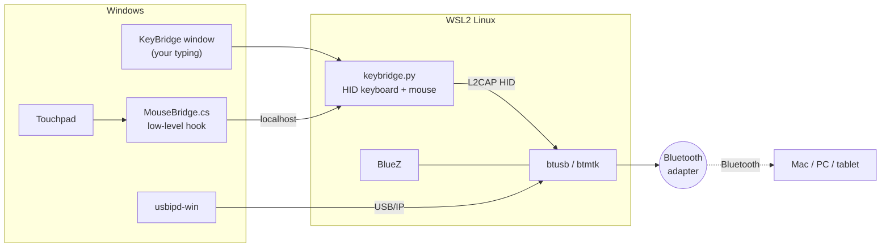

<div align="center">


# KeyBridge

**Use your Windows laptop as a Bluetooth keyboard and mouse for any other device.**

A new Mac stuck on *"Set up your Bluetooth keyboard"* with no keyboard around, a tablet, a TV, a second PC:
pair it with your laptop and type.

[](https://github.com/Mikigb77/keybridge/actions/workflows/ci.yml)
[](LICENSE)


</div>

---

## Why

Windows can be a Bluetooth *host* (it connects keyboards), but it can't *be* a Bluetooth keyboard:
there is no API for the HID device role, and the Bluetooth LE route is blocked
(`E_ACCESSDENIED` when advertising as a keyboard). Linux can.

KeyBridge lends your laptop's Bluetooth adapter to the Linux that **WSL2** already runs, and uses
**BlueZ** to present it as a genuine Bluetooth keyboard + mouse. Hosts see an ordinary keyboard: it
pairs from setup assistants and reconnects on its own. Everything runs from one double-click and gives
Bluetooth back to Windows when you're done.

## Features

- ⌨️ **Real Bluetooth HID keyboard + mouse** (classic BR/EDR, combo device). Works with setup
  assistants, no app needed on the other device.
- 🖱️ **Touchpad forwarding:** move, click, right/middle click and scroll on the other device. `Ctrl+G`
  toggles it; the laptop pointer stays still meanwhile.
- 🔁 **Automatic reconnection** to devices it was paired with, like a real keyboard.
- 🧩 **Detects your hardware:** finds the USB Bluetooth adapter and its chip vendor, installs the
  right firmware, and builds a driver if your chip needs one (MediaTek).
- 🛡️ **Self-healing start:** closes leftover sessions, restores lost pairing keys from a backup,
  detects stuck Bluetooth and repairs it, and works around known WSL/systemd pitfalls.
- 🔙 **Gives Bluetooth back** to Windows when you quit.

## Requirements

- Windows 10 (21H2+) or 11, x64, with **WSL2** and a Debian / Ubuntu / Kali distribution
  (`wsl --install -d Ubuntu` if you have none). systemd is enabled automatically.
- A **USB-connected Bluetooth adapter**. Most laptop adapters are USB (often half of the Wi-Fi card);
  a USB Bluetooth dongle works too.
- Administrator rights. [usbipd-win](https://github.com/dorssel/usbipd-win) is installed
  automatically (via winget) on first run.

While KeyBridge runs, Windows can't use Bluetooth itself (earbuds, controllers, Bluetooth mice).

## Quick start

1. **Download** this repository (*Code → Download ZIP*, then right-click the ZIP → Properties →
   **Unblock** → extract), or `git clone https://github.com/Mikigb77/keybridge`.
2. **Double-click `Start-KeyBridge.cmd`** and accept the admin prompt.
   The first run installs what's missing; with a MediaTek adapter it also offers a one-time driver
   build (~20 minutes).
3. **On the other device**, open its Bluetooth settings or keyboard setup assistant and pick
   **KeyBridge**. If it shows a code, type it in the KeyBridge window and press Enter.
4. **Type in the KeyBridge window.** Press `Ctrl+G` to send the touchpad too.

After the first run a **KeyBridge** shortcut appears in the folder; use it from then on.

## Controls

| Key | Action |
|---|---|
| *typing* | Goes to the other device (letters, numbers, symbols, Enter, Backspace, Tab, Esc, arrows, Delete) |
| `Ctrl+G` | Send the touchpad / mouse to the other device; again to bring it back (Alt+Tab also does) |
| `Ctrl+L` | Switch keyboard layout (`us` ↔ `es-mac`) |
| `Ctrl+Q` | Quit; asks whether to give Bluetooth back to Windows |

## Settings

Edit [`settings.ini`](settings.ini):

| Setting | Default | Meaning |
|---|---|---|
| `HostLayout` | `us` | Keyboard layout configured **on the other device** (`us`, `es-mac`) |
| `DeviceName` | `KeyBridge` | Name shown when pairing |
| `MouseSpeed` | `1.0` | Pointer speed factor on the other device |
| `Distro` | *(default)* | WSL distribution to use |
| `AdapterId` | *(auto)* | USB id of the adapter (`usbipd list`), if detection picks the wrong one |
| `MousePort` | `47321` | Local port between the touchpad helper and WSL |

## How it works



1. **usbipd-win** forwards the laptop's USB Bluetooth adapter into the WSL2 VM.
2. **`prepare.sh`** sets up BlueZ as a keyboard (class of device, no input plugin), loads the drivers
   and firmware, and backs up pairings.
3. **`keybridge.py`** publishes an HID service record (keyboard + mouse report descriptor), accepts or
   opens the HID L2CAP channels, and turns your keystrokes into HID reports for the host's layout.
4. **`MouseBridge.cs`** hooks the touchpad on Windows and streams movement, buttons and wheel to
   `keybridge.py` over localhost.

The full write-up, including the dead ends and the failures that shaped the design, is in
**[docs/how-it-works.md](docs/how-it-works.md)**. The MediaTek driver build (matching symbol CRCs of
a kernel you didn't build) is explained in **[docs/building-drivers.md](docs/building-drivers.md)**.

## Compatibility

| | Status |
|---|---|
| MediaTek MT7922, Windows 11, WSL kernel 6.18 | ✅ Tested (one-time driver build) |
| Intel, Realtek, Broadcom, Qualcomm USB adapters | 🟡 Use WSL's stock drivers; untested, reports welcome |
| macOS host, including the setup assistant (Mac mini) | ✅ Tested: keyboard and mouse |
| Windows, Linux, Android, iPadOS hosts | 🟡 Standard Bluetooth HID; expected to work, untested |

Tried it on other hardware? Please [open an issue](https://github.com/Mikigb77/keybridge/issues) with
what worked; it helps the next person.

## Limitations

- Keys reach the other device by typing **in the KeyBridge window**. Modifier shortcuts
  (Cmd/Ctrl/Option + key) and function keys aren't forwarded yet.
- Layouts: `us` and `es-mac` so far (adding one is a small, self-contained change, see
  [CONTRIBUTING.md](CONTRIBUTING.md)).
- Windows has no Bluetooth of its own while KeyBridge runs.
- While running, KeyBridge is discoverable with "Just Works" pairing, like a keyboard in pairing
  mode. See [Security and privacy](docs/how-it-works.md#security-and-privacy).

## Troubleshooting

Most problems print a `!!` line telling you what to do. For everything else, see
**[docs/troubleshooting.md](docs/troubleshooting.md)**.

## Project layout

```
Start-KeyBridge.cmd    Stop-KeyBridge.cmd    settings.ini
windows/   Start-KeyBridge.ps1, Stop-KeyBridge.ps1, Common.ps1  - orchestration (PowerShell 5.1)
           MouseBridge.cs                                       - touchpad capture (C#, low-level hook)
wsl/       keybridge.py                                         - Bluetooth HID keyboard + mouse (Python, BlueZ)
           prepare.sh                                           - Linux setup (packages, BlueZ, drivers, firmware)
           build-drivers.sh, kcrc.py                            - MediaTek driver build for WSL's kernel
docs/      how-it-works.md, troubleshooting.md, building-drivers.md
```

## Contributing

Issues and pull requests are welcome, especially compatibility reports and new keyboard layouts.
See [CONTRIBUTING.md](CONTRIBUTING.md).

## License

[MIT](LICENSE). Kernel modules built by `build-drivers.sh` are compiled on your machine from
Microsoft's GPL-2.0 WSL kernel source; none are distributed here.

## Acknowledgements

Built on [BlueZ](http://www.bluez.org/), [usbipd-win](https://github.com/dorssel/usbipd-win) and
[WSL](https://github.com/microsoft/WSL).
