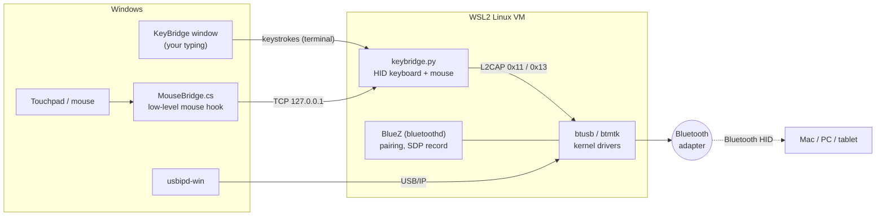

# How KeyBridge works

KeyBridge makes a Windows laptop behave like an off-the-shelf Bluetooth keyboard and mouse. This
document explains the moving parts, why each one is built the way it is, and the failure modes that
shaped the design.

- [Why Windows can't do this on its own](#why-windows-cant-do-this-on-its-own)
- [Architecture](#architecture)
- [Moving the Bluetooth adapter into Linux](#moving-the-bluetooth-adapter-into-linux)
- [Becoming a keyboard](#becoming-a-keyboard)
- [Pairing and reconnecting](#pairing-and-reconnecting)
- [Typing](#typing)
- [The mouse](#the-mouse)
- [Lessons learned](#lessons-learned)
- [Security and privacy](#security-and-privacy)

## Why Windows can't do this on its own

A Bluetooth keyboard is a *peripheral* that implements the HID profile. Windows only exposes the
*host* side of Bluetooth HID to applications:

- **Classic Bluetooth (BR/EDR):** there is no public API to register an HID *device* service, to
  accept the HID L2CAP channels (PSM 0x11 / 0x13) as a device, or to change the adapter's Class of
  Device so other machines see "keyboard".
- **Bluetooth Low Energy:** an app can publish an HID-over-GATT service (0x1812), but hosts only
  connect to a keyboard whose *advertisement* says so. Adding the fields a keyboard needs (Appearance
  0x03C1, the 16-bit service UUID list) to `BluetoothLEAdvertisementPublisher` fails with
  `E_ACCESSDENIED`. Manufacturer data works, so this is a platform restriction, not a bug.

Linux's Bluetooth stack (BlueZ) has no such restrictions. KeyBridge therefore lends the laptop's
Bluetooth adapter to the Linux kernel that WSL2 already runs, and lets BlueZ do the radio work.

## Architecture

| Component | Runs on | Role |
|---|---|---|
| `Start-KeyBridge.ps1` | Windows (admin) | Orchestration: cleanup, adapter handover, starts everything |
| `MouseBridge.cs` | Windows, inside that PowerShell | Captures the touchpad/mouse while Ctrl+G is on |
| usbipd-win | Windows | Forwards the USB Bluetooth adapter to the WSL2 VM over USB/IP |
| `prepare.sh` | WSL, root | Packages, BlueZ config, drivers, firmware, pairing backup |
| `keybridge.py` | WSL, root | The HID device itself: SDP record, L2CAP channels, reports |

## Moving the Bluetooth adapter into Linux

Most laptop Bluetooth adapters are USB devices (often half of a Wi-Fi + Bluetooth combo card).
[usbipd-win](https://github.com/dorssel/usbipd-win) can forward such a device into WSL2:

1. `usbipd bind --force` replaces the Windows driver so the device can be shared.
2. On composite adapters, Windows' own Bluetooth interface (USB interface 0) still holds the device
   (`Device busy (exported)`), so KeyBridge disables it for the session and re-enables it afterwards.
3. `usbipd attach --wsl` hands the device to the VM, where the Linux `btusb` driver picks it up.

Order matters: the right Linux drivers must be loaded **before** attaching, or the stock driver binds
first. And in WSL even USB support (`usbcore`) is a loadable module that nothing loads before the
first attach, so `prepare.sh` loads every dependency of the drivers explicitly.

**MediaTek adapters** need one more step: WSL's kernel is built without
`CONFIG_BT_HCIBTUSB_MTK`, so its `btusb` refuses them. `build-drivers.sh` builds `btusb` + `btmtk`
for the exact running kernel; [building-drivers.md](building-drivers.md) explains how a module built
outside Microsoft's build is made to load into their kernel.

The firmware the chip loads at power-up must be visible to the VM's kernel, not just to the
distribution, so `prepare.sh` stages it in `/mnt/wsl` and points `firmware_class.path` there.

## Becoming a keyboard

`keybridge.py` turns BlueZ into a classic Bluetooth HID combo device:

- **No input plugin.** `bluetoothd` runs with `-P input`; otherwise its own HID *host* code would
  grab the HID L2CAP channels that the emulator needs.
- **Service record.** An HID SDP record (subclass `0xC0`: keyboard + pointing device) is published
  through `org.bluez.ProfileManager1`; the L2CAP control (PSM 0x11) and interrupt (PSM 0x13)
  channels are accepted directly with sockets.
- **Class of Device** `0x0025C0` (peripheral, keyboard + pointing), so hosts show a keyboard icon and
  setup assistants accept it.
- **HID report descriptor** with two reports:

  | Report ID | Content | Size |
  |---|---|---|
  | 1 | Keyboard: modifiers, reserved byte, 6 key codes (+ LED output report) | 8 bytes |
  | 2 | Mouse: 5 buttons, X/Y as 16-bit relative values, wheel, horizontal pan | 7 bytes |

- **Control channel.** `SET_PROTOCOL`/`GET_PROTOCOL` (boot vs. report mode), `SET_IDLE`/`GET_IDLE`,
  `GET_REPORT` and `SET_REPORT` (keyboard LEDs) are answered so hosts don't give up on the device.
- **Pairing agent** with `NoInputNoOutput` capability, i.e. "Just Works" pairing.

## Pairing and reconnecting

Two behaviours of real keyboards turned out to matter:

1. **Limited discoverable mode.** macOS' keyboard setup assistant never connected while the adapter
   was in normal (general) discoverable mode, and connected within seconds in *limited*
   discoverable mode, which is what keyboards use while pairing. It times out after 180 s, so
   KeyBridge refreshes it.
2. **The keyboard calls the host, not the other way round.** Once paired, a host stops scanning and
   waits for its keyboard to connect, as a real keyboard does on the first key press. While nothing
   is connected, KeyBridge therefore opens the HID channels *to* every paired host every few seconds.

A Mac that had paired while KeyBridge was keyboard-only picked up the new keyboard + mouse descriptor
on the next reconnection; no re-pairing was needed.

## Typing

Keys are typed into the KeyBridge window, which `keybridge.py` reads in raw terminal mode.
Each character becomes one or more HID key presses (press report, then release report).

The **host's** keyboard layout decides what a key code means, so KeyBridge needs a map per host
layout: on a Mac set to "Spanish - ISO", `@` is Option+2, not Shift+2. Accented characters are typed
with dead keys (´ then e for é). `Ctrl+L` cycles through the layouts while running.

## The mouse

WSL can't see the laptop's touchpad, so the mouse is captured on Windows by `MouseBridge.cs`, which is
compiled at runtime with `Add-Type` and runs inside the (elevated) KeyBridge PowerShell process.

- **Low-level mouse hook (`WH_MOUSE_LL`)**, not Raw Input: precision touchpads don't reliably produce
  raw mouse input, and a hook can also *swallow* events so the laptop's pointer stays still and
  clicks don't land on Windows while the mouse belongs to the host.
- **Movement** = position the event would move the pointer to, minus where it currently is (it's held
  still, parked mid-screen so there's room in every direction). Buttons and wheel are forwarded too.
- **DPI gotcha.** The hook reports positions in physical pixels, but inside the hook callback
  `GetCursorPos` follows the *process'* DPI mode, not the thread's. At 150% display scaling the two
  disagree and every movement came out ~20x too large. The process is made per-monitor DPI aware.
- **Transport.** Text lines over TCP to `127.0.0.1` (WSL2 forwards localhost into the VM):
  `M dx dy`, `B mask`, `W v h`, and `G1`/`G0` to capture or release. `keybridge.py` merges events
  to at most ~125 reports/s so the Bluetooth link never builds up a queue (that would show as lag).
- **Never stuck.** The pointer comes back if another window comes to the front (Alt+Tab, Windows
  key), if the host disconnects, or if either side stops.

## Lessons learned

These are the failures that shaped the current design. Each one is guarded against in the code.

| Symptom | Root cause | Guard |
|---|---|---|
| Host can no longer connect, and you can't fix it on the host because this *is* its keyboard | The laptop-side pairing was deleted; the host still holds its half and waits for the same key | Pairing files are backed up on every start and restored automatically if missing; there is no "forget" command. (A lost key was once recovered by scanning the WSL disk image for the deleted file.) |
| Keyboard dies ~90 s after every start | One out-of-memory kill in the WSL VM leaves `oom_kill 1` in `init.scope`'s cgroup. systemd's default `OOMPolicy=stop` then stops `init.scope` (which holds WSL's own init and every `wsl.exe` session) on each boot and SIGKILLs it after the 90 s stop timeout | `DefaultOOMPolicy=continue`; if a boot is already stopping, the distribution is restarted once |
| Keyboard crashes at start with a D-Bus error; `hci0` *and* `hci1` exist | The adapter was detached from WSL while a host was connected, leaving a "ghost" adapter the kernel never removes, which kept the name `hci0` | The adapter is never reset between sessions; Linux Bluetooth is shut down before detaching; ghosts are detected and WSL restarted (with consent); the adapter is found by asking BlueZ, not by assuming `hci0` |
| Driver fails to load right after `wsl --shutdown` ("Unknown symbol usb_alloc_urb") | `usbcore` is a module in WSL and nothing loaded it yet | Dependencies are loaded from each module's `depends` field |
| Two windows fight over the mouse; Bluetooth disappears from a working session | An earlier session was still open, and its "Give Bluetooth back?" prompt detached the adapter | Every start closes earlier sessions first |
| A custom `.exe` launcher was blocked ("Windows cannot access the specified device, path, or file") | Endpoint security blocks unknown, unsigned executables that launch PowerShell | The launcher is a `.cmd` plus a shortcut to Windows' own PowerShell |

## Security and privacy

- **While KeyBridge runs, the laptop is a discoverable keyboard in pairing mode** using "Just Works"
  pairing, like a real keyboard waiting to be paired. A nearby device could pair with it and receive
  what you type. Only run it while you need it, and stop it with Ctrl+Q.
- **The touchpad hook is only active while you're sending the mouse** (Ctrl+G); otherwise every event
  passes straight through. It sees mouse input only, never keystrokes.
- **The Windows ↔ WSL link listens on `127.0.0.1` only** and carries mouse movement, nothing else.
- Nothing is sent anywhere except over Bluetooth to the paired host. Package installation and the
  optional driver build download from your distribution's repositories and from
  `github.com/microsoft/WSL2-Linux-Kernel`.
